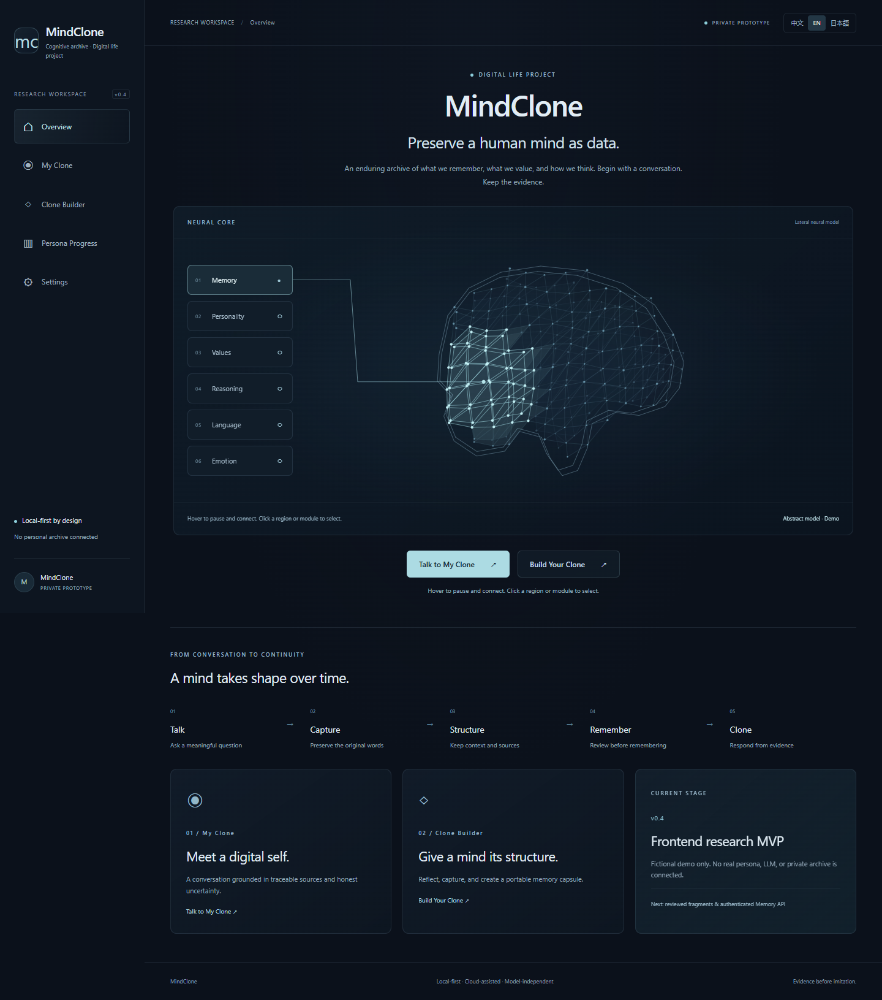
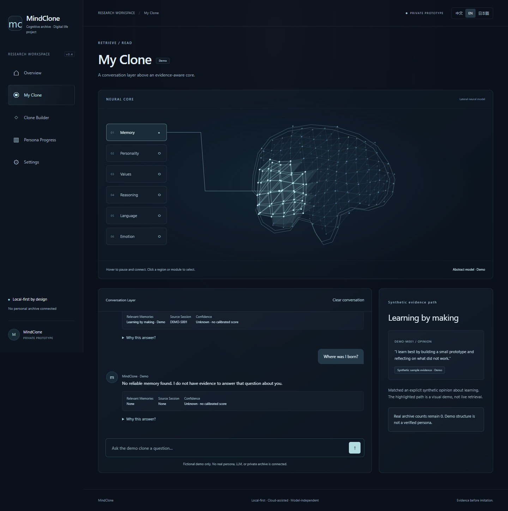
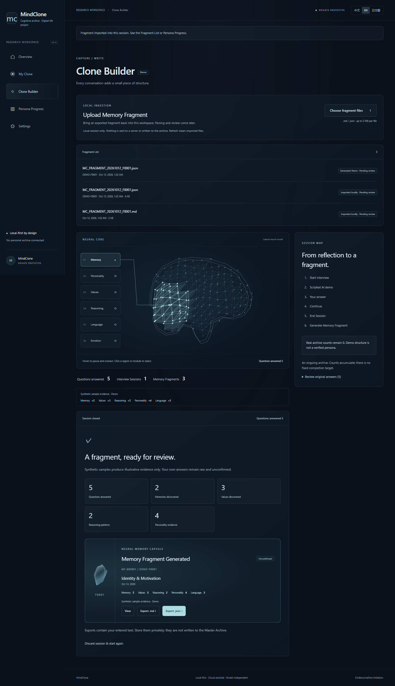
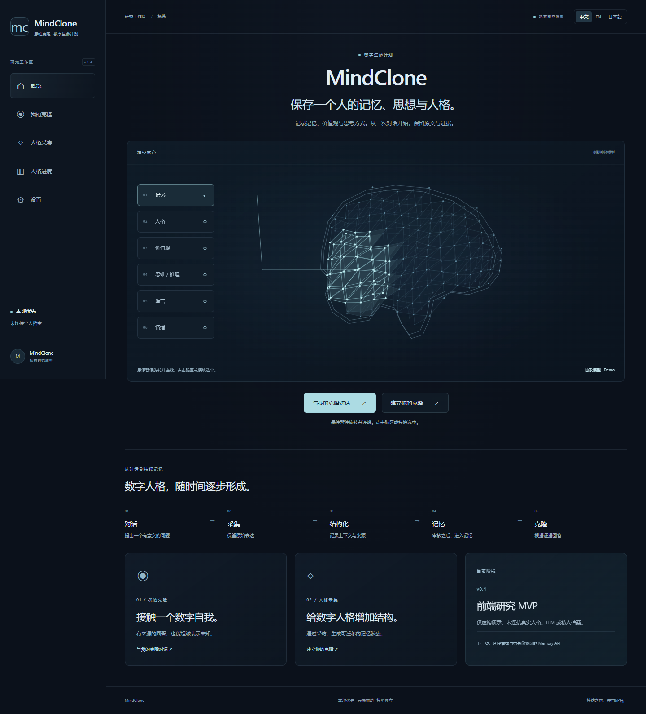
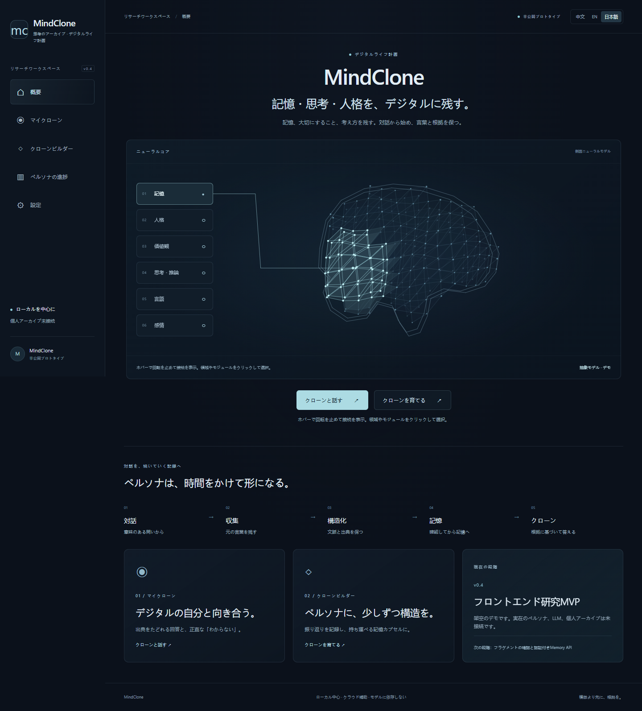
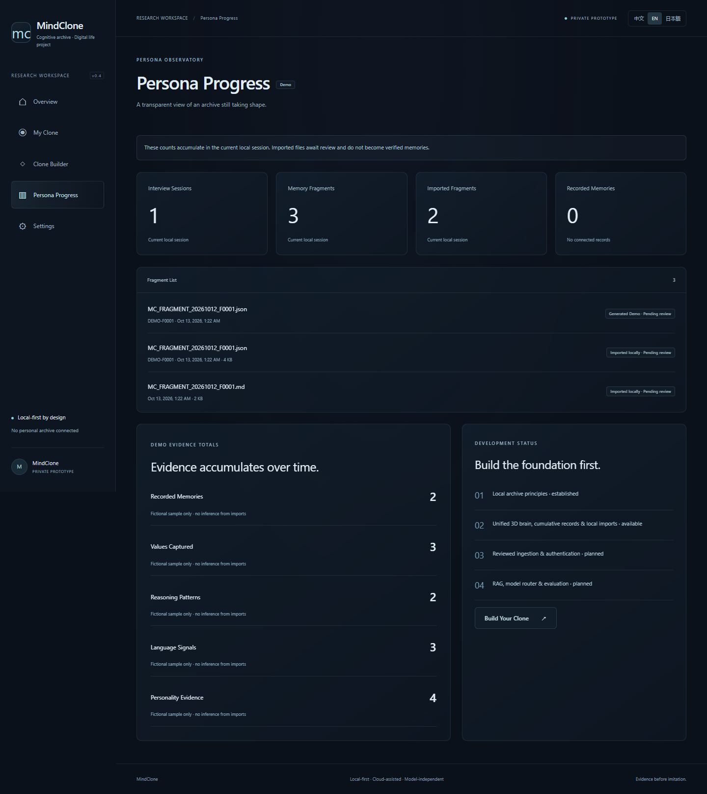
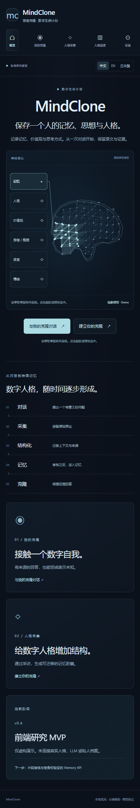

# MindClone
### 思维克隆 · 数字生命计划

**Preserve a human mind as data.**

保存一个人的记忆、思想与人格。 / 記憶・思考・人格を、デジタルに残す。

**Local-first · Cloud-assisted · Model-independent**

> Private Research Prototype · v0.4 · Local execution only



## What is MindClone?
MindClone is a long-term digital persona research project. It preserves original words, memories, values, opinions, language, and reasoning with sources and context. Its aim is a portable archive that can support an evidence-aware digital self over time, without depending on one model or platform.

思维克隆关注一个人经历了什么、如何做决定、为什么改变，而不只是模仿说话语气。这个原型供获邀的老师、同学和研究合作者体验流程；它不声称已经复制意识或形成真实人格。

## Why?
A conversation can disappear and a model can change. Human stories and ways of thinking deserve a durable, revisable archive. Original answers remain distinct from AI analysis; missing evidence remains visible rather than being invented.

## How it works
**Talk → Capture → Structure → Remember → Clone**

**Raw → Structured → Memory → Persona → Clone**

The local Master Archive remains the source of truth. This Web module is a separately versioned interface under `09_CODE/web`, with no archive access or migration. It demonstrates capture and evidence presentation; real ingestion and retrieval are future work.

## My Clone
A Digital Brain sits above the Conversation Layer. Select Memory, Personality, Values, Reasoning, Emotion, or Language to explore a region. Each panel shows zero real records and an honest empty state. Chat answers expose Relevant Memories, Source Session, Confidence, and “Why this answer?”.

Try the supported fictional learning question in any language. Its Memory + Reasoning regions pulse briefly to illustrate a synthetic evidence path. This is visual feedback from a deterministic fixture, **not live retrieval or an LLM**. An unsupported biography question returns **No reliable memory found**. Confidence is unknown; no numeric accuracy is invented.

## Clone Builder
Start Interview → scripted AI question → original answer → follow-up → End Session → Generate Memory Fragment.

Captured answers, generated sessions and fragments accumulate as counts. There is no percentage, completion bar or lifetime target. Exact fictional samples still provide illustrative source-based counts; arbitrary answers remain raw and unconfirmed. Verified archive counts remain zero.

## Digital Brain UI
All three pages use the same abstract lateral/cross-section brain model: original silhouette, triangulated points, edges and translucent faces. Canvas 2D projects a real XYZ mesh with perspective and depth ordering; SVG draws one restrained folded connector to the selected or hovered left-side module. No Three.js, WebGL, downloaded image or external model is required.

Memory, Personality, Values, Reasoning, Language and Emotion are a single vertical column on the left. Click either a module or the brain surface to select; no region detail, record page or navigation is created. Keyboard buttons and the focused canvas arrow keys provide selection.

The model rotates slowly around its Y axis. Hover over the brain pauses rotation; leaving resumes at the current angle. Reduced-motion preferences stop rotation while preserving interaction. Mobile uses a smaller mesh, DPR capped at 1 and lower frame frequency; desktop DPR is capped at 1.5. Offscreen and hidden-tab animation stops, and renderer resources are cleaned up when routes change. Fonts use a shared system sans-serif stack; raw file previews retain a readable code font.

## Three languages
中文 / English / 日本語 switch instantly without reloading. All core UI copy, questions, sample answers, empty states, privacy text and Markdown headings live in:

```text
locales/zh.json
locales/en.json
locales/ja.json
```

Default language follows the browser locale, with English fallback. A manual choice saves only `mindclone.language` in localStorage. Switching language preserves unsent drafts, original answers, messages, fragment identity and creation time. Raw text is never translated or rewritten. Generated UI labels and demo replies follow the selected language.

## Neural Memory Capsule
Fragments appear as a minimal illuminated memory shard, with `MF-000001`, `DEMO-F0001`, interview theme, date, source-derived Demo counts, View and Export actions. Markdown and JSON downloads use:

```text
MC_FRAGMENT_YYYYMMDD_F0001.md
MC_FRAGMENT_YYYYMMDD_F0001.json
```

F0001 and MF-000001 are **demo identifiers**, not production allocation. They do not replace existing v0.1 archive entity IDs. Downloads may share a suggested filename; production requires transactional unique IDs, schema validation, privacy review and an explicit import. Nothing is written to the Master Archive.

## Upload Memory Fragment
Clone Builder includes a local file picker for `.md` and `.json` fragments. Export either format, then re-import it to the current workspace. Imported files appear in Fragment List and Persona Progress, with local timestamp, source ID when available, and Pending review status.

No file is uploaded to a server, saved into Git, written to the Master Archive or persisted in browser storage. Refresh clears the local session. Markdown stays raw; JSON receives only basic syntax/object validation. Imported claims never contribute to verified memory/persona counts or chat retrieval. Limits: 2 MB per file, 20 staged entries and 6 MB of imported text per session. Exact duplicates are not added twice.

The Core import/list/totals interfaces and future FragmentIngestPort reserve validation, review and authorized persistence. Real parsing and database writes remain future work. Only fictional round-trip fixtures are used in screenshots.

## Architecture
```text
Clone Builder ── Capture / Write ──┐
                                  ↓
                            MindClone Core
                                  ↕
                            Persona Database
                                  ↑
My Clone ── Retrieve / Read ──────┘
```

Both interfaces share DemoCore. Typed contracts reserve SQLite/PostgreSQL repositories, reviewed Memory API, RAG, LLM Router, AuthSession, AuthPort and server-side AccessPolicy. They are interface boundaries, not active services. See [architecture](docs/ARCHITECTURE.md).

## Privacy-first, local-first
- **Repository is Private.** At the visibility audit, only the owner had access; no collaborator invitations were issued. The owner manages future invitations.
- Repository privacy and website authentication are separate. This local app has no login system yet. Do not expose it on a network or deploy private data behind a frontend-only login screen.
- GitHub Pages is not configured. We do not assume ordinary Pages restricts visitors to private-repository collaborators. Local demonstration is the current delivery method.
- Future deployment must enforce server-side identity, an allowlist and authorization for the site **and every Memory API operation**, using an authenticated hosting/access layer. No deployment was performed in this iteration.
- Only code, documentation, translation dictionaries and fictional screenshots enter this code repository. A strict Git allowlist still excludes private archives, raw interviews, SQLite, Vault, secrets, environment files and downloaded fragments.
- No real memory or database enters the frontend bundle. Even a private Git repository is not a Vault.
- Input remains in page memory; refresh clears it. Only language preference is saved. No analytics or external model requests run. The static server serves reviewed assets on 127.0.0.1 only.
- Exported files contain entered text. Store them privately. JSON candidates use stable semantic keys; Markdown renders their labels in the chosen language while preserving raw words.

`MindClone-Private` remains a reserved future data-layer concept. No extra repository or private data publication was created.

## Current progress
- [x] Existing public repository changed to Private and owner-only access audited.
- [x] Minimal Futuristic dark interface, Digital Brain and left-side region selection.
- [x] Evidence-aware conversation and restrained synthetic-source feedback.
- [x] Progressive interview mesh, honest capture cumulative records and memory capsule.
- [x] Exact fictional specimen extraction; arbitrary input remains unconfirmed raw capture.
- [x] Three-language UI, browser locale detection and preference persistence.
- [x] Keyboard region controls and reduced-motion support.
- [x] Desktop/mobile screenshots and automated checks.
- [ ] Server authentication, authorized deployment and Memory API.
- [ ] Reviewed real archive ingestion, production ID allocation and database adapter.
- [ ] Retrieval, model routing and clone evaluation.

## Roadmap
**Next:** fragment review, unique identifiers, schema mapping and an authenticated local Memory API. Preserve the central MINDCLONE_ROOT resolver and relative archive paths.

**Then:** identity/ownership checks, an invitation-controlled deployment layer, permission-filtered retrieval and model routing. Repository collaborator status alone must never authorize a record read.

**Later:** temporal persona views, contradictions, source inspection and memory/persona evaluation. Fine-tuning, payments, full accounts and archive migration remain outside this MVP.

## Run locally
Node.js 22 or newer is required for JSON module import attributes. No package installation is needed.

```sh
node server.mjs
```

Open http://127.0.0.1:4173. Routes: `#home`, `#clone`, `#builder`, `#dashboard`, `#settings`. `PORT` can select another local port.

```sh
node --test
```

Optional browser validation uses an existing Playwright installation and Microsoft Edge. Set `MC_TEST_DEPENDENCIES` to its node_modules directory and `MC_TEST_URL` to the running local server, then run `node ui-check.mjs`. See [validation](docs/VALIDATION.md).

## Screenshots
All screenshots show fictional samples or zero connected records.

| My Clone | Clone Builder |
|---|---|
|  |  |

| 中文 | 日本語 |
|---|---|
|  |  |

| Persona Progress | Mobile |
|---|---|
|  |  |

## Inviting a mentor
The owner can use **Repository → Settings → Collaborators → Add people**. The invited GitHub user can access this private repository **after accepting the invitation**. This does not create authenticated website access. Personal-account repository collaborator permissions include write access; if you require a read-only role, review organization repository roles before inviting.

[GitHub invitation documentation](https://docs.github.com/en/repositories/managing-your-repositorys-settings-and-features/repository-access-and-collaboration/inviting-collaborators-to-a-personal-repository) · [personal repository permissions](https://docs.github.com/en/repositories/managing-your-repositorys-settings-and-features/repository-access-and-collaboration/permission-levels-for-a-personal-account-repository).

## Presentation walkthrough
Overview → select a brain region without navigation → switch language → My Clone → learning sample → unsupported life question → Clone Builder → fictional answers → End Session → Generate Memory Fragment → inspect and export → Persona Progress. Real records remain at zero throughout.
